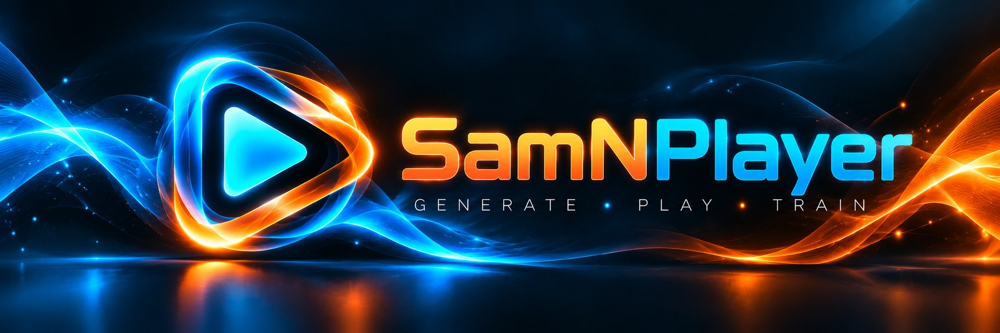
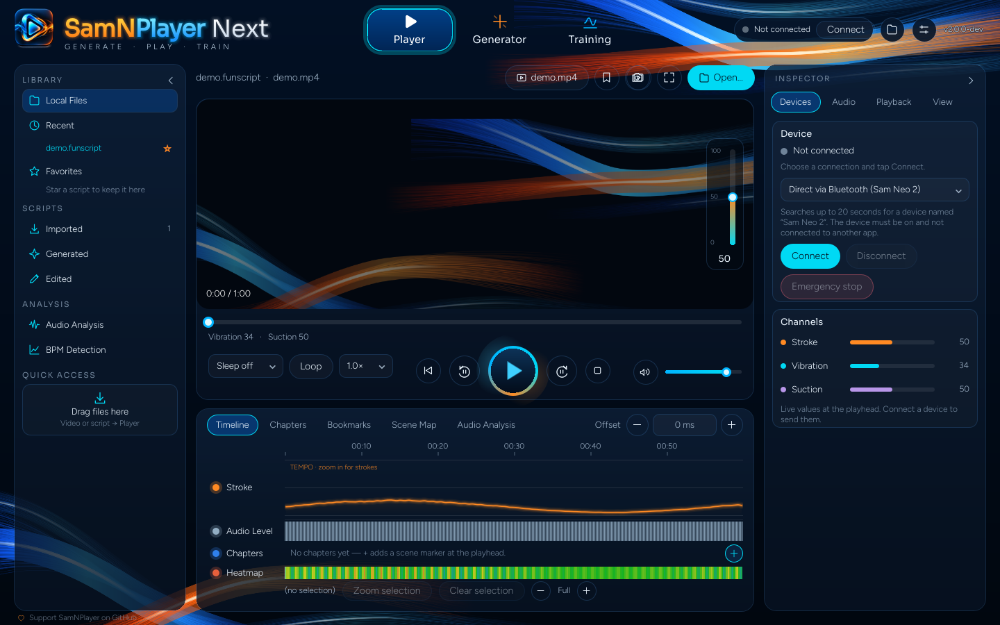
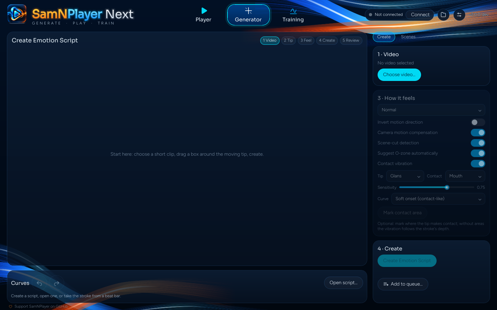
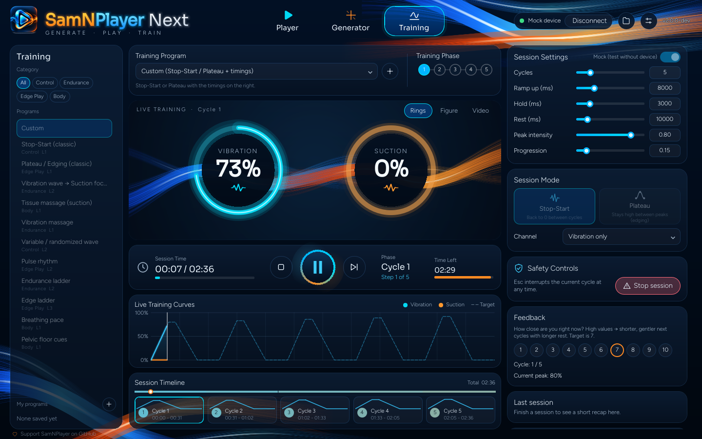
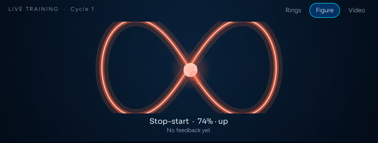

<p align="center">
  
</p>

<h1 align="center">SamNPlayer Next</h1>

<p align="center">
  <strong>Generate · Play · Train</strong> — a free, open-source desktop app for
  <code>.funscript</code> / <code>.samn</code> scripts. Made for the SVAKOM Sam&nbsp;Neo&nbsp;2,
  and open to strokers and other devices. Everything runs locally.
</p>

<p align="center">
  <a href="https://github.com/funfunpayer/SamNPlayer-Next-Level/actions/workflows/ci.yml"></a>
  
  
  
</p>

<p align="center">
  <a href="#the-modes">Modes</a> ·
  <a href="#devices">Devices</a> ·
  <a href="#download">Download</a> ·
  <a href="#build-from-source">Build</a> ·
  <a href="#support">Support</a> ·
  <a href="docs/DECISIONS.md">Decisions</a>
</p>

---

SamNPlayer Next is the successor of [SamNPlayer 0.7 / 0.8](https://github.com/funfunpayer/SamNPlayer),
rebuilt from the ground up in **C++** with **Qt 6** and a **QML** interface in the animated Flow look.
It keeps every function of 0.7 and 0.8 (the checklist is [`docs/PARITY.md`](docs/PARITY.md)) and is
faster, smaller and open source.

> **Status:** in development. Every CI run builds a Windows test package (see [Download](#download)).
> The first release follows when the Player, Generator and Training are complete.

## The modes

One window, three modes. The tab row at the top switches between them (or <kbd>Ctrl</kbd>+<kbd>1</kbd>…<kbd>3</kbd>).
The device connection, the folder button and Settings sit on the right and are shared by all modes.

### Player

Play a script with its video and your device. The Library is on the left and the Inspector
on the right (devices, audio, playback, view); both slide away for more room. The timeline below
shows the stroke curve, the audio level, chapters and the heatmap. A fast script seen from far away
becomes a calm **tempo** wave; zooming in shows the single strokes.

<p align="center">
  
</p>

**Open a video or a script** with *Open…*, <kbd>Ctrl</kbd>+<kbd>O</kbd>, or by dropping it onto the window.
A video brings its script along when one with the same name lies beside it (also in script folders and
as variants such as *Soft* / *Hard*). Without a script, the Player offers *Create script*, which opens the
Generator with that video.

### Generator

Make a script from your own video in five steps: video → tip & contact → feel → create → review.
Classical tracking does the work; nothing is written without you. The Generator is also the
**Editor**: open any script, drag, add or delete points, undo / redo, and prepare it for a device.
Several videos can wait in a queue.

<p align="center">
  
</p>

### Training

Guided sessions — stop-start, plateau or a program with phases — with live rings, live curves next to
the planned target, and a session timeline. In the middle sit **End · Play/Pause · Interrupt**: Pause really
holds the device at 0 and stops the clock, and <kbd>Esc</kbd> interrupts the current cycle at any time.
The rings follow your device: a vibrator shows only vibration.

<p align="center">
  
</p>

The stage switches between **Rings**, the abstract **Flow figure** (an infinity loop that opens with the
level) and **Video**: your own film plays while the session runs and pauses when it stops. The device
always follows the training, not the film.

<p align="center">
  
</p>

## Devices

| Connection | Devices |
|---|---|
| Direct via Bluetooth | SVAKOM Sam Neo 2 (vibration and suction) |
| TCode over Wi-Fi or USB | OSR2, SR6 and other TCode devices |
| Intiface Central (Buttplug) | the devices Intiface supports |
| Mock device | no hardware, for trying things out |

Settings → Device has a function test, a raw value test and a diagnostics table.

## Download

**Nothing needs to be installed.** SamNPlayer Next for Windows is a portable folder: unzip it and start
`SamNPlayer2.exe`. Settings and logs live in `%APPDATA%\SamNPlayer2`; to remove the app, delete the folder.

- **Test builds (now):** every CI run on `main` builds the Windows package.
  Open [Actions → CI](https://github.com/funfunpayer/SamNPlayer-Next-Level/actions/workflows/ci.yml?query=branch%3Amain),
  click the newest green run and download **SamNPlayer2-windows-x64** under *Artifacts*
  (you need to be signed in to GitHub).
- **Releases (later):** finished versions will be on the
  [Releases page](https://github.com/funfunpayer/SamNPlayer-Next-Level/releases); the app tells you when
  a new one is out (Settings → General → Updates).

The builds are not signed yet, so Windows SmartScreen may warn: *More info* → *Run anyway*.
Linux builds run in CI; Linux packages follow later.

## Build from source

You need CMake 3.21+, a C++17 compiler and Qt 6.4+ (Quick, Multimedia, Svg, Network, WebSockets,
SerialPort, Bluetooth). The Generator's tracking needs OpenCV. Releases are built with Qt 6.7 and its
FFmpeg multimedia backend.

```bash
cmake -S . -B build -DSAMN_BUILD_PYTHON=OFF
cmake --build build --parallel
ctest --test-dir build
./build/app/samnplayer path/to/video.mp4
```

| Folder | What |
|---|---|
| `core/` | C++17 library without Qt: formats, mapping, filters, beat bar, script search, settings, playback, training |
| `vision/`, `engine/` | frames and tracking for the Generator, and the detection engine (a built-in plugin) |
| `app/` | Qt 6 app: C++ controllers (`src/`) and the QML interface (`qml/`) |
| `tests/` | core tests (doctest) and app tests (Qt Test, offscreen) |

How we work: [`CONTRIBUTING.md`](CONTRIBUTING.md). Plan and decisions: [`docs/PLAN.md`](docs/PLAN.md),
[`docs/DECISIONS.md`](docs/DECISIONS.md), [`docs/ROADMAP.md`](docs/ROADMAP.md).

## Support

SamNPlayer Next is free. A ⭐ on GitHub, a bug report or an idea in the
[issues](https://github.com/funfunpayer/SamNPlayer-Next-Level/issues) helps it grow.
A project website (GitHub Pages) and donation links follow later.

## Licence

Open source under GPL-3.0-or-later ([`LICENSE`](LICENSE)), the detection engine included as a built-in plugin.
Details in [`LICENSING.md`](LICENSING.md), third-party code in [`THIRD_PARTY.md`](THIRD_PARTY.md),
goals in [`docs/MANIFEST.md`](docs/MANIFEST.md).

The screenshots use synthetic test data only.
